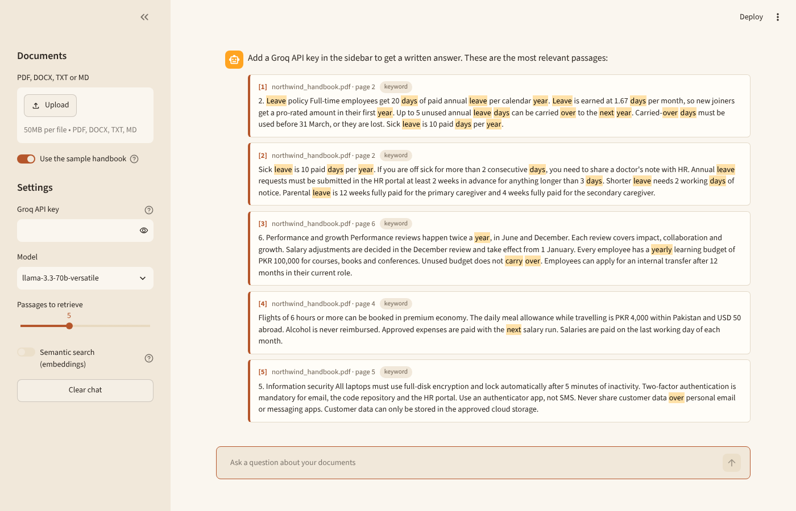

# RAG Document Assistant

Ask questions about your own PDFs and documents and get answers that **only use what's in the files**, with a page reference on every claim. It uses hybrid search (keyword + semantic), a relevance guard against made-up answers, and GPT-OSS 120B through Groq.


*The sample handbook loaded, with a cited answer and the source passage it came from (matching words highlighted).*

## Features

- **Upload PDF, DOCX, TXT or Markdown.** Several files at once is fine.
- **Hybrid retrieval:** BM25 keyword search plus `bge-small-en-v1.5` embeddings, merged with Reciprocal Rank Fusion
- **Page-level citations:** every answer sentence cites a numbered passage, and the source cards show the file, page and highlighted text
- **Grounded answers only:**
  - The prompt forbids outside knowledge.
  - A relevance check stops the LLM from being called at all when nothing in the documents matches ("What's the capital of Australia?" gets *"I couldn't find that in the uploaded documents"*).
- **Streaming answers** and short chat memory for follow-up questions
- **Works offline for search.**
  - Embeddings run locally (ONNX, CPU, no API key).
  - If the model can't load, the app falls back to keyword search instead of crashing.
  - Without a Groq key you still get the matching passages.
- **Retrieval evaluation** with labelled questions (Hit@k and MRR)
- **Unit tests** for loading, chunking, fusion, the relevance guard and citation parsing

## How it works

```
 files ──► loader ──► page text ──► chunker ──► chunks (~450 chars, sentence-aligned, never cross a page)
                                                    │
                                ┌───────────────────┴───────────────────┐
                                ▼                                       ▼
                          BM25 index                           embeddings (bge-small)
                                └──────────► Reciprocal Rank Fusion ◄───┘
                                                    │
                                     relevance guard (skip LLM if nothing matches)
                                                    │
                                 numbered passages + rules ──► Groq (GPT-OSS 120B) ──► answer [1][2]
```

**Design choices**
- **Chunks never cross a page boundary,** so each chunk has exactly one page number and citations can't point to the wrong page.
- **RRF instead of mixing raw scores.** BM25 scores and cosine similarities sit on completely different scales. RRF only uses ranks, so it needs no tuning.
- **Keyword search is kept alongside embeddings** because it's better at exact things like amounts, policy names and acronyms. Semantic search catches paraphrases ("time off" vs "annual leave").

## Quick start

```bash
git clone https://github.com/f451h/rag-document-assistant
cd rag-document-assistant
pip install -r requirements.txt
cp .env.example .env          # paste your free Groq key from console.groq.com
streamlit run app.py
```

The app opens with a sample company handbook loaded, so you can try it straight away. The embedding model (~130 MB) downloads on first use.

## Evaluation

`eval/questions.json` has 24 questions about the sample handbook, each labelled with the page that holds the answer. Many are phrased differently from the document on purpose (e.g. *"Can I fly business class on a long trip?"*).

```bash
python -m eval.evaluate
```

| Method | Hit@1 | Hit@3 | Hit@5 | MRR |
|---|---|---|---|---|
| Keyword (BM25) | 0.88 | 0.92 | 0.92 | 0.896 |
| Semantic (bge-small embeddings) | **0.96** | **1.00** | **1.00** | **0.979** |
| Hybrid (RRF) | 0.92 | **1.00** | **1.00** | 0.944 |

**What this shows**
- Keyword search misses 2 of 24 questions completely. Both are paraphrased: *"How far ahead do I have to request a week of vacation?"* (the handbook says "annual leave requests ... at least 2 weeks in advance") and *"When can I move to a different team internally?"* (the handbook says "internal transfer").
- Semantic and hybrid search both put the right page in the top 3 for **every** question. Since the model reads the top 5 passages, that's what decides answer quality.
- On this small, clean handbook, semantic search alone ranks slightly better at position 1. I keep hybrid as the default anyway, because keyword matching guards against cases where embeddings struggle and this handbook doesn't test: exact codes, names, amounts and acronyms in real documents. With only 24 questions, the gap between 0.96 and 0.92 is a single question.

## Tests

```bash
pytest -q
```

A small fake embedder lets the tests cover the hybrid search path without downloading a model.

## Project structure

```
app.py               Streamlit UI
rag/loader.py        PDF / DOCX / TXT parsing with page numbers
rag/chunker.py       sentence-aware chunking with overlap
rag/embeddings.py    local embeddings (fastembed)
rag/retriever.py     BM25 + dense + RRF, relevance guard
rag/llm.py           prompt, Groq client, citation parsing
eval/                labelled questions + retrieval metrics
scripts/             generates the sample handbook PDF
tests/               pytest suite
```

## Ideas for next steps

- A cross-encoder re-ranker on the top 20 passages
- A persistent vector store (Chroma / Qdrant) for large document sets
- Answer-level evaluation (faithfulness and citation accuracy) with an LLM judge
